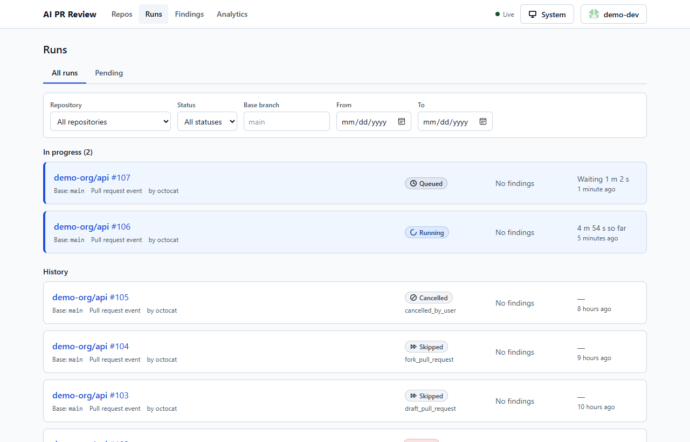
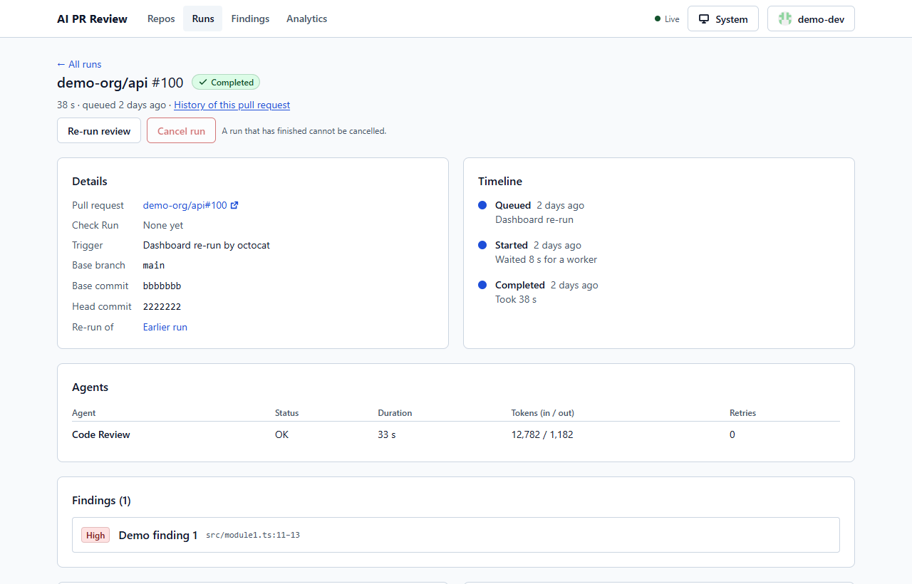
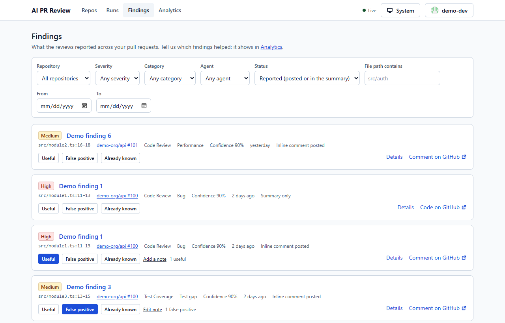
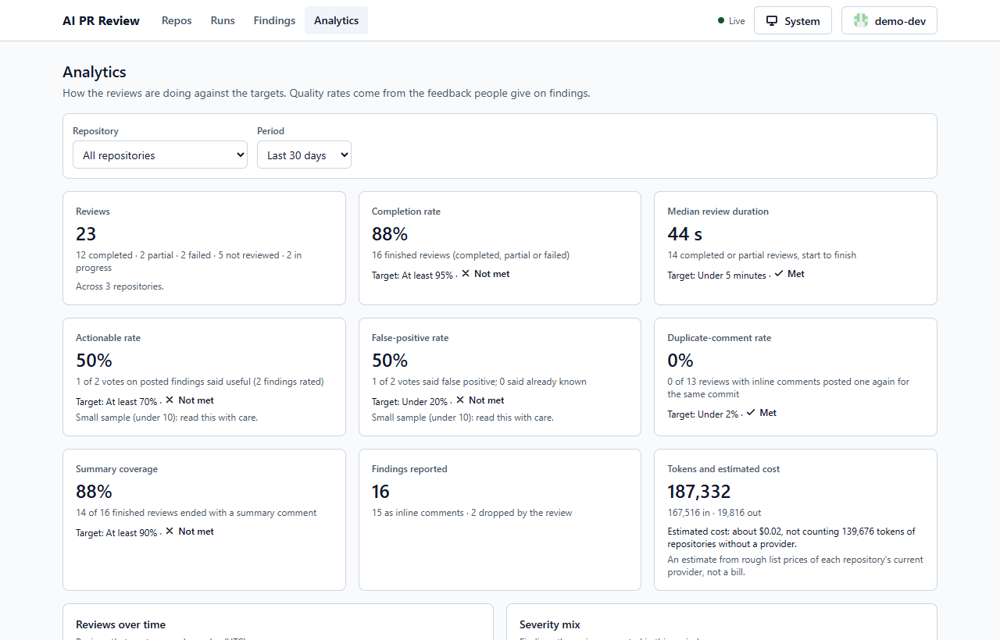
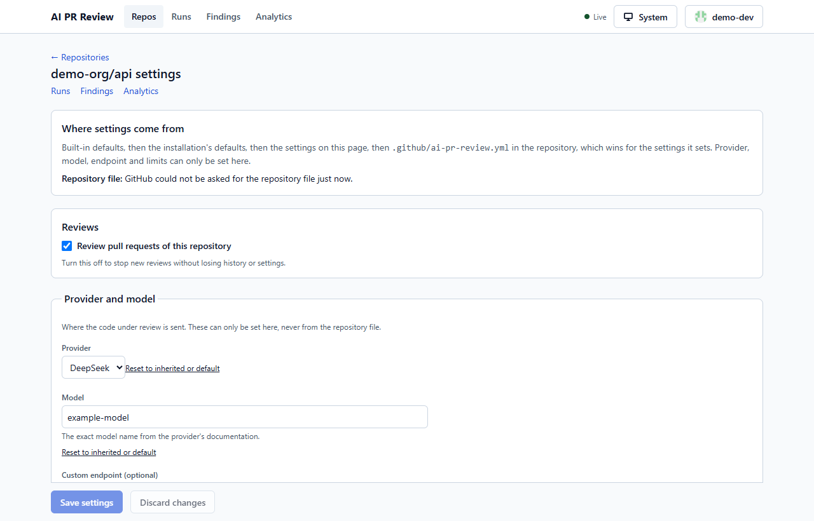

# AI PR Review Platform

A GitHub App that reviews pull requests with AI, and a dashboard to see every review.

You install the App on a repository. When someone opens a pull request, three AI agents read the changes and post feedback right on the pull request. Every review is saved, so you can look back at it, give feedback on it and see how useful the AI really is.



---

## Table of contents

1. [The problem](#the-problem)
2. [What this project does](#what-this-project-does)
3. [Features](#features)
4. [How it works](#how-it-works)
5. [Tech stack](#tech-stack)
6. [Screenshots](#screenshots)
7. [Project structure](#project-structure)
8. [Getting started](#getting-started)
9. [Useful commands](#useful-commands)
10. [Configuration](#configuration)
11. [Security and privacy](#security-and-privacy)
12. [Testing](#testing)
13. [Project status](#project-status)
14. [More documentation](#more-documentation)

---

## The problem

Code review is slow. Reviewers are busy, small mistakes slip through, and teams often forget to add tests or miss security problems.

AI can help, but most simple tools just dump a long wall of text on the pull request. That is noisy, it repeats itself on every push, and nobody can tell if it is actually useful.

## What this project does

This project is a full platform, not just a script:

- It **listens** to GitHub when a pull request is opened or updated.
- It **reads** the changed code through the GitHub API (it never downloads or runs your code).
- It **asks an AI model** to review it, using your own API key.
- It **posts** the result on the pull request: inline comments, one summary and a status check.
- It **saves** everything in a database and shows it in a **web dashboard**.

You choose the AI provider: **DeepSeek, Anthropic (Claude) or OpenAI**.

## Features

### What you see on the pull request

- **Inline comments** on the exact lines, but only for findings the AI is confident about. Less noise.
- **One summary comment** that is updated in place, so the pull request never fills up with repeated comments.
- **A Check Run** called `AI PR Review`. It can be set to only inform, or to fail the pull request when serious problems are found.
- **Commands**: comment `/ai-review` on a pull request to run the review again.

### The three AI agents

| Agent | What it does |
|---|---|
| **Code Review** | Finds bugs, risky logic and quality problems in the changed code. |
| **Test Coverage** | Suggests tests that are missing. If your CI uploads an LCOV report, it also measures how much of the *changed lines* are covered. Suggestions and measured numbers are always labelled differently, so they are never confused. |
| **Security** | Looks for injection, missing auth checks, hard-coded secrets, SSRF, XSS, weak crypto and risky new dependencies. It is advisory. It does not replace tools like CodeQL or `npm audit`. |

### The dashboard

- **Sign in with GitHub** and see only your own repositories.
- **Live runs list**: watch a review go from pending to running to done, in real time.
- **Run detail**: a timeline, what each agent did, which files were skipped and why, and every finding.
- **Findings explorer**: search and filter all findings, with their history.
- **Feedback**: mark a finding as *useful*, *false positive* or *already known*.
- **Analytics**: see how useful the reviews are compared with the product's targets.
- **Pull request history**, **audit log**, **CSV export** and **re-run / cancel** buttons.
- **Settings**: choose provider and model, add API keys, set enforcement rules and retention.
- Light and dark themes, and works on a phone.

### Built for real use

- **Many users at once (multi-tenant)**: each installation's data is isolated, also at the database level with row-level security.
- **API keys are encrypted** (AES-256-GCM envelope encryption) and are never shown again after saving. Keys can be rotated or revoked.
- **No duplicate work**: webhooks are verified and idempotent. The same event twice creates one review. A new push cancels the old review.
- **Safe on failure**: if the AI times out or returns bad output, you get a safe partial result instead of a crash.
- **Fork pull requests are safe**: no keys are exposed and nothing is executed.
- **Limits and quotas** per installation, with the reason recorded when a run is stopped.
- **Ready to deploy**: Docker images, a production Docker Compose file, health checks, Prometheus metrics, backup and restore scripts.

## How it works

```
 GitHub pull request
        │  webhook (signature verified)
        ▼
   ┌─────────┐      ┌─────────┐      ┌──────────────┐
   │   API   │ ───► │  Queue  │ ───► │    Worker    │
   │ Fastify │      │ BullMQ  │      │ runs agents  │
   └─────────┘      └─────────┘      └──────┬───────┘
        ▲                                   │ reads the diff (GitHub API)
        │ REST + live events                │ asks the AI provider
        │                                   │ posts comments + Check Run
   ┌─────────┐      ┌──────────────┐        ▼
   │Dashboard│ ◄─── │  PostgreSQL  │ ◄── saves runs and findings
   │  React  │      └──────────────┘
   └─────────┘
```

1. A pull request is opened or updated. GitHub sends a **webhook** to the API.
2. The API checks the signature, creates a **run** in the database and puts it in the **queue**.
3. A **worker** picks the run up, collects a safe and size-limited view of the changes, and runs the agents.
4. The worker validates the AI answers, saves the **findings**, and **publishes** the comments, summary and Check Run to GitHub.
5. The **dashboard** shows all of this live.

## Tech stack

| Area | Tools |
|---|---|
| Language | TypeScript everywhere, Node.js 24 |
| API | Fastify, Zod (validation), OpenAPI |
| Queue | BullMQ on Redis |
| Database | PostgreSQL, Drizzle ORM, row-level security |
| Dashboard | React 19, Vite, React Router, TanStack Query, Tailwind CSS, Radix UI |
| AI | DeepSeek, Anthropic and OpenAI behind one interface |
| GitHub | GitHub App (webhooks, OAuth sign-in, Check Runs) |
| Testing | Vitest, Testing Library, MSW, Playwright, axe (accessibility) |
| Deployment | Docker, Docker Compose, nginx, Prometheus metrics |

## Screenshots

| | |
|---|---|
|  |  |
|  |  |

_The screenshots show the fictional demo data created by `npm run db:seed`._

## Project structure

This is an npm workspaces monorepo.

```
apps/
  api/        Fastify server: webhooks, GitHub sign-in, REST API, live events
  worker/     Takes runs from the queue, runs the agents, publishes results
  web/        The React dashboard
packages/
  core/       The review engine: GitHub client, context, AI providers, agents, publisher
              (no HTTP server and no database, so it is easy to test)
  db/         Database schema, migrations, seed data, tenant-scoped access
  queue/      BullMQ queue, retries, dead letters, rate limits
  shared/     Types, schemas, typed API client, logger that hides secrets
acceptance/   Acceptance tests that trace every requirement (AC-1 to AC-23)
docs/         Scope, design, decisions, guides, operations, privacy, costs
docker/       Dockerfile, nginx config
scripts/      Dev, ops, backup and helper scripts
```

## Getting started

To run it for real, follow the [self-hosting guide](docs/self-hosting.md). To develop on it locally:

### You need

- **Node.js 24 or newer** and npm
- **Docker** with Docker Compose (for PostgreSQL and Redis)
- A **GitHub App** (the setup guide below shows how)

### Steps

```bash
npm install
cp .env.example .env     # then fill in the values
npm run db:up            # starts PostgreSQL and Redis
npm run db:migrate       # creates the tables
npm run db:see           # optional: fake demo data to look at
npm run dev              # api (3000), worker, web (5173)
```

Check that it runs:

```bash
curl http://localhost:3000/healthz   # {"status":"ok"}
curl http://localhost:3000/readyz    # 200 when PostgreSQL and Redis are up
```

Open the dashboard at http://localhost:5173.

### Connecting GitHub

The API needs a GitHub App and two secrets (`SESSION_SECRET`, `ENCRYPTION_KEY`). The full step-by-step guide is **[docs/github-integration.md](docs/github-integration.md)**: what the App needs (permissions, events, URLs), how to register it, install it on a test repository, sign in, add your AI provider key and see your first review. The short technical reference is [docs/github-app-setup.md](docs/github-app-setup.md).

In short:

1. Create a GitHub App: `npm run github-app:register -- --webhook-url <smee.io or tunnel URL>`
2. Copy the generated `GITHUB_*` values into `.env`, and add `SESSION_SECRET` and `ENCRYPTION_KEY`.
3. Install the App on a private test repository.
4. Run `npm run dev`, sign in at http://localhost:5173, add your AI provider key in Settings.
5. Open a pull request.

Without a real GitHub App you can still try the webhook endpoint:

```bash
npm run webhook:replay
```

If an environment variable is missing, the app stops at startup and lists only the **names** of what is missing, never the values.

## Useful commands

| Command | What it does |
|---|---|
| `npm run dev` | Runs api, worker and web together |
| `npm run build` | Builds every app |
| `npm test` | Runs all tests |
| `npm run check` | Lint, format check, typecheck, tests and build (what CI runs) |
| `npm run acceptance` | Runs the acceptance suite (AC-1 to AC-23) |
| `npm run db:up` / `db:down` | Start / stop PostgreSQL and Redis |
| `npm run db:migrate` | Apply database migrations |
| `npm run db:seed` | Load demo data |
| `npm run webhook:replay` | Send a saved webhook to the local API |
| `npm run github-app:register` | Register a development GitHub App |
| `npm run credentials:rotate` | Re-encrypt stored keys after changing `ENCRYPTION_KEY` |
| `npm run e2e -w @ai-pr-review/web` | Browser tests with Playwright |

## Configuration

Review settings are layered. A later one wins over an earlier one:

> defaults → installation defaults (dashboard) → repository settings (dashboard) → optional `.github/ai-pr-review.yml` file

Example: [examples/ai-pr-review.yml](examples/ai-pr-review.yml). Settings that affect cost or safety (`provider`, `model`, `base_url`, `limits`) can only be changed in the dashboard, so a pull request can never change them.

To measure test coverage, upload an LCOV report from your CI as a GitHub Actions artifact: [examples/upload-coverage.yml](examples/upload-coverage.yml).

## Security and privacy

- The platform **never checks out or runs** your code. It only reads diffs through the GitHub API.
- Webhooks are checked with their **signature**. Fork pull requests get no secrets.
- Provider keys are **encrypted** and **write-only**. Secrets are removed from logs and from anything posted to GitHub.
- Prompt-injection and secret-leak tests are part of the test suite.
- You decide what is sent to the AI provider and for how long data is kept ([docs/privacy.md](docs/privacy.md)).

> **Note:** if you choose DeepSeek, code from reviewed pull requests is sent to DeepSeek's hosted API, run by a China-based company. Pick another provider if that is not acceptable.

## Testing

- **Unit and integration tests** with Vitest, against a real PostgreSQL and Redis.
- **Acceptance suite**: every requirement (AC-1 to AC-23) is linked to a named test ([docs/acceptance.md](docs/acceptance.md)).
- **Browser tests** with Playwright, including accessibility checks in light and dark mode.
- **Chaos tests** that kill the worker, Redis and PostgreSQL while reviews run.
- A mock AI provider and an in-memory GitHub make the tests fast and repeatable.

## Project status

All planned features are implemented and covered by automated tests.

**Honest note:** the tests use a mock AI provider and a fake GitHub. The platform has **not yet run against a real GitHub App or a real AI provider**, no pilot has been done and `v1.0.0` is not tagged. [docs/pilot.md](docs/pilot.md) lists what remains.

Out of scope for now: billing, other Git hosts (GitLab, Bitbucket), running repository code, automatic fix patches, SSO/SAML and mobile apps.

## More documentation

| You want to | Read |
|---|---|
| Connect the project to GitHub, step by step | [GitHub integration guide](docs/github-integration.md) |
| Use the dashboard | [User guide](docs/user-guide.md) |
| Configure repositories and rules | [Admin guide](docs/admin-guide.md) |
| Host it yourself | [Self-hosting](docs/self-hosting.md), [Operations](docs/operations.md) |
| Know what data is sent and stored | [Privacy](docs/privacy.md) |
| Estimate the cost | [Costs](docs/costs.md) |
| Understand what was built and why | [Scope](docs/scope.md), [Design](docs/design.md), [Decision log](docs/decision-log.md), [PRD](docs/PRD-v0.1.md) |
| See what changed | [Changelog](CHANGELOG.md), [Release notes](docs/release-notes-v1.0.0.md) |

## License

MIT (see `package.json`). Add a `LICENSE` file before publishing.
